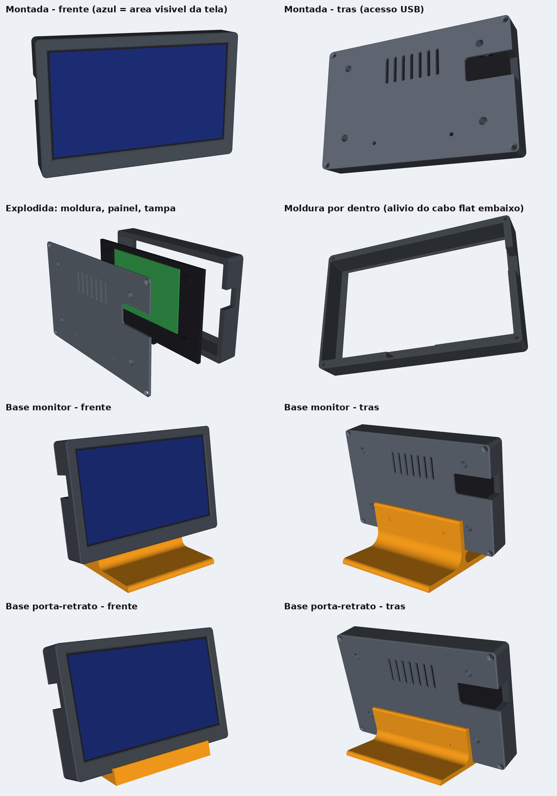

# Caixa para o painel Waveshare ESP32-S3-Touch-LCD-7

Caixa impressa em 3D, tipo moldura, para o painel de voos (Waveshare ESP32-S3-Touch-LCD-7, 800×480), com duas opções de base.
A tela entra por trás da moldura e a tampa traseira fecha o conjunto.



## Arquivos para imprimir (`stl/`)

| Arquivo | O que é | Tamanho | Como imprimir |
|---|---|---|---|
| `moldura.stl` | Frente: moldura + paredes | 174,9 × 112,4 × 23 mm | Face da frente na mesa (como está no arquivo), sem suporte |
| `tampa.stl` | Tampa traseira com os postes | 174,9 × 112,4 × 16,5 mm | Face de fora na mesa (como está no arquivo), sem suporte |
| `base_porta_retrato.stl` | Base simples, berço inclinado 15° | 83 × 39 × 110 mm | Deitada sobre o perfil (como está no arquivo), sem suporte |
| `base_monitor.stl` | Base tipo monitor, inclinada 10° | 114 × 55 × 110 mm | Deitada sobre o perfil (como está no arquivo), sem suporte |

Caixa montada: 174,9 × 112,4 × 25 mm. Sugestão: PLA ou PETG, camada 0,2 mm, 3 perímetros, 15–20 % de preenchimento.
A face da moldura fica com o acabamento da mesa de impressão.

## Parafusos

- 4 × M3×6 — tampa nas abas roscadas do painel. Não use mais comprido: pode encostar no LCD.
- 4 × M3×10 cabeça chata (escareada) — tampa na moldura. Abrem rosca direto no plástico (furo-guia de 2,6 mm).
- 2 × M3×12 + 2 porcas M3 — base na tampa (opcional).

## Montagem

1. Se for usar base, encaixe as 2 porcas M3 nos alojamentos sextavados por dentro da tampa.
2. Com a moldura virada para baixo, deite o painel dentro dela, com o cabo flat no alívio da parede de baixo.
3. Ligue o cabo USB-C na porta "USB" (ao lado do módulo ESP32) e deixe-o sair pelo rasgo da parede lateral.
4. Feche a tampa: os 4 postes apoiam nas abas roscadas do painel.
5. Parafuse os 4 M3×6 nos rebaixos da tampa (6,5 mm de diâmetro, 13,5 mm de profundidade).
   No fundo de cada rebaixo há uma película de 0,24 mm que permite imprimir sem suporte; fure com o próprio
   parafuso ou com uma broca de 3,5 mm.
6. Parafuse os 4 M3×10 dos cantos.
7. Base: 2 parafusos M3×12 por trás. A base porta-retrato também funciona só encaixada, sem parafusos.

O recorte da USB continua na tampa, então dá para ligar e desligar o carregador com a caixa fechada.

## Medidas usadas

Do desenho oficial da Waveshare:

- Chapa traseira: 165,72 × 97,60 mm
- 4 abas M3: 126,20 mm entre centros na horizontal (19,76 mm de cada lado); abas de cima a 13,64 mm da borda de cima,
  abas de baixo a 18,31 mm da borda de baixo
- Área visível: 153,84 × 85,632 mm. A posição dela dentro do painel foi lida no desenho (≈ 4,2 mm da borda esquerda e
  ≈ 3,4 mm da borda de cima); a abertura da moldura passa 1,2 mm da área visível em cada lado para cobrir esse erro.

Medidas no painel:

- Do vidro da tela até o topo do componente mais alto: 20 mm (`ALTURA_TOTAL`)
- Espessura do módulo LCD, do vidro até a chapa traseira: 4 mm (`PAINEL_ESP`)
- Porta USB-C usada: a "USB", começando a 30,5 mm da borda de cima (centro ≈ 35 mm)
- Cabo flat: sai no centro da borda de baixo, ≈ 34 mm de largura e ≈ 3,5 mm para fora (estimado pela foto).
  O alívio tem 42 mm de largura e 5,5 mm de profundidade (`FLAT_L`, `FLAT_PROF`).

Estimada (não consta no desenho oficial — conferir com paquímetro):

| Parâmetro no script | Valor | O que é |
|---|---|---|
| `ABA_H` | 2,5 mm | Altura das abas roscadas acima da chapa traseira |

## Moldura e espessura

A moldura visível tem 9,3 mm nos lados e em cima e 15,1 mm embaixo. A faixa de baixo é maior porque a tela tem uma
borda morta de 8 mm ali e o cabo flat precisa de espaço para a dobra.

Profundidade = moldura na frente do vidro (1,6) + folga (0,4) + `ALTURA_TOTAL` (20) + folga (1,0) + tampa (2,0) = **25 mm**.

A posição do painel em profundidade é definida pelos postes da tampa, que encostam nas abas. Com `ABA_H` = 2,5 mm sobra
0,4 mm entre o vidro e a moldura. Se as abas forem mais altas que ~2,9 mm, a tampa não assenta: lixe os postes ou ajuste
`ABA_H`. Se forem mais baixas, sobra uma folga maior entre o vidro e a moldura.

## Ajustar e gerar de novo

```bash
pip install cadquery
python3 gerar_caixa.py
```

Todos os parâmetros estão no topo de `gerar_caixa.py`.
