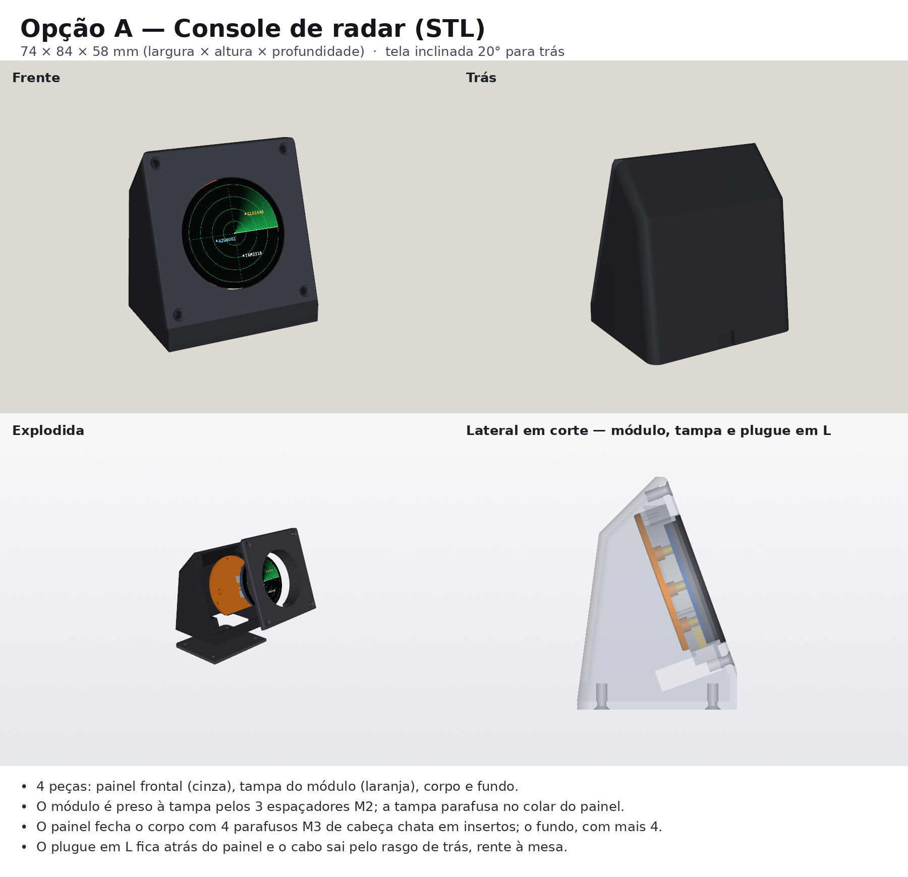

# Radar de mesa — caixa para a Waveshare ESP32-S3-Touch-AMOLED-1.75

Duas opções de caixa de mesa para a tela redonda de 1,75", com a USB-C voltada para baixo e espaço para um plugue em L.
O módulo fica girado 90° em relação ao desenho da Waveshare; a imagem deve ser girada no firmware.

| Opção A — Console de radar | Opção B — Instrumento sobre pedestal |
|---|---|
|  |  |
| 74 × 84 × 58 mm, tela inclinada 20° | 66 × 80 × 62 mm, tela inclinada 15° |

## Arquivos para imprimir (`stl/`)

Todos já estão na posição de impressão e não precisam de suporte.

| Opção | Arquivo | O que é | Como fica na mesa de impressão |
|---|---|---|---|
| A | `opcao_a/painel.stl` | Painel frontal com o colar do módulo | Face da frente para baixo |
| A | `opcao_a/corpo.stl` | Corpo em cunha | Em pé, como no uso |
| A | `opcao_a/fundo.stl` | Fundo | Deitado |
| A | `opcao_a/tampa.stl` | Tampa traseira do módulo | Face de fora para baixo |
| B | `opcao_b/frente.stl` | Cabeça + pescoço | Face da frente para baixo |
| B | `opcao_b/base.stl` | Base | Deitada |
| B | `opcao_b/tampa.stl` | Tampa traseira do módulo (igual à da opção A) | Face de fora para baixo |

Sugestão: PLA ou PETG, camada 0,2 mm, 3 perímetros, 15–20 % de preenchimento. Para dar peso, imprima o fundo (A) e a
base (B) com 100 % de preenchimento e use pés de borracha.

## Ferragens

| | Opção A | Opção B |
|---|---|---|
| Parafuso M2×6 (módulo na tampa e tampa no colar) | 6 | 6 |
| Inserto a quente M3 × 5 × 4,5 | 8 | 2 |
| Parafuso M3×8 de cabeça chata | 8 | — |
| Parafuso M3×12 de cabeça chata | — | 2 |

Os 3 parafusos M2 que entram nos espaçadores do módulo não devem ter mais que 6 mm: o espaçador tem 3,5 mm de altura.
Os outros 3 M2 abrem rosca direto no plástico do colar (furo-guia de 1,7 mm).

## Montagem

Comum às duas opções:

1. Apoie o módulo na tampa, com a USB-C do lado do corte reto, e prenda com 3 parafusos M2×6 nos espaçadores.
2. Encaixe o conjunto por trás no colar (o vidro fica rente à face da frente) e prenda a tampa com mais 3 M2×6.

Opção A:

3. Coloque os 8 insertos no corpo: 4 na moldura da frente e 4 embaixo.
4. Ligue o plugue em L no módulo, passe o cabo por dentro do corpo e encaixe-o no rasgo de trás.
5. Feche o painel com 4 parafusos M3×8 e depois o fundo com mais 4.

Opção B:

3. Coloque os 2 insertos embaixo do pescoço.
4. Suba o plugue em L pelo pescoço até a USB-C; o cabo sai pelo rasgo de trás.
5. Prenda a base com 2 parafusos M3×12.

## Medidas usadas

Do desenho oficial: vidro Ø 48,96 mm, placa Ø 46 mm, 6,90 mm do vidro ao verso da placa, espaçadores M2 de 3,5 mm
(topo a 10,40 mm do vidro), USB-C a 23,80 mm do centro.

Estimadas:

- Componentes mais altos do verso (barra de pinos e conectores SPK/BAT): até 12,5 mm do vidro, lido no desenho.
  A tampa fica a 13,4 mm.
- Plugue em L: 12 × 7 mm, 10 mm de cotovelo e 16 mm de trecho rígido saindo para trás da tela. O rasgo tem 14,4 mm de
  largura. Na opção A sobra espaço dentro do corpo para plugues maiores ou com saída lateral; na opção B o canal do
  pescoço tem 16 mm de largura, então só serve plugue com saída para trás.

Não há acesso aos botões PWR e BOOT.

## Ajustar e gerar de novo

```bash
pip install cadquery
python3 gerar_stl.py
```

`render_previa.py` refaz as imagens de conferência e `gerar_mockups.py` os mockups iniciais (pasta `mockups/`);
os dois precisam de `pillow`, `vtk` e de um display (`xvfb-run -a python3 render_previa.py`).
