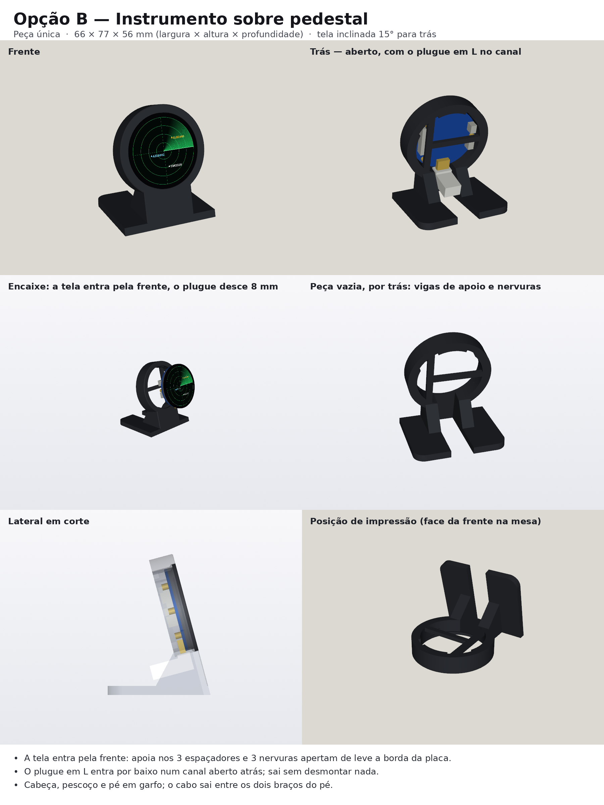

# Radar de mesa — suporte para a Waveshare ESP32-S3-Touch-AMOLED-1.75

Duas opções de suporte de mesa para a tela redonda de 1,75", cada uma em **peça única**, sem parafusos:

- a tela entra pela frente e fica encaixada;
- a USB-C fica voltada para baixo e o plugue em L entra por um canal aberto atrás, então o cabo sai sem desmontar nada.

O módulo fica girado 90° em relação ao desenho da Waveshare; a imagem deve ser girada no firmware.

| Opção A — Console de radar | Opção B — Instrumento sobre pedestal |
|---|---|
|  |  |
| 74 × 81 × 58 mm, tela inclinada 20° | 66 × 77 × 56 mm, tela inclinada 15° |

## Arquivos para imprimir (`stl/`)

| Arquivo | O que é | Altura de impressão |
|---|---|---|
| `opcao_a.stl` | Console: face inclinada, duas laterais e piso, aberto atrás | 55 mm |
| `opcao_b.stl` | Instrumento: cabeça, pescoço e pé em garfo | 54 mm |

Os dois já estão na posição de impressão, com a face da frente na mesa, e não precisam de suporte.
As duas vigas atrás do módulo são impressas em ponte (até 40 mm de vão): deixe a ventilação de ponte ligada.

Sugestão: PLA ou PETG, camada 0,2 mm, 3 perímetros, 15–20 % de preenchimento. Pés de borracha embaixo ajudam a peça
a não escorregar quando você toca na tela.

## Como a tela encaixa

1. Empurre o módulo pela frente, com a USB-C para baixo, apertando pela borda (não pelo centro do vidro).
2. Os 3 espaçadores M2 do verso encostam em duas vigas atrás; o vidro fica rente à face, 0,1 mm para dentro.
3. Três nervuras (em cima e nas duas diagonais de baixo) apertam a borda da placa em 0,1 mm e seguram o módulo.
   A inclinação da tela também o mantém no lugar.
4. Para tirar, empurre por trás, pelo vão entre as vigas.

Se o encaixe ficar solto ou apertado demais, ajuste `APERTO` em `gerar_stl.py` (0,10 mm por nervura) e gere de novo.
Folga em volta do vidro: 0,25 mm (`R_VIDRO`).

## Cabo USB

O plugue em L sobe por um canal de 16 mm de largura, aberto atrás, até a USB-C. Para soltar, puxe o plugue 8 mm para
baixo e retire por trás; há espaço para isso sem levantar a peça. O cabo sai rente à mesa: pelo rasgo do piso na
opção A, entre os dois braços do pé na opção B.

## Medidas usadas

Do desenho oficial: vidro Ø 48,96 mm, placa Ø 46 mm, 6,90 mm do vidro ao verso da placa, espaçadores M2 de 3,5 mm
(topo a 10,40 mm do vidro), USB-C a 23,80 mm do centro.

Estimadas:

- Componentes mais altos do verso (barra de pinos e conectores SPK/BAT): até 12,5 mm do vidro, lido no desenho.
- O que passa da borda da placa (botões PWR/BOOT e a ponta da barra de pinos): há rasgos no furo nesses três pontos,
  posicionados pelo desenho.
- Plugue em L: 12 × 7 mm, 10 mm de cotovelo e 16 mm de trecho rígido saindo para trás da tela.

Não há acesso aos botões PWR e BOOT pela frente; por trás o módulo fica exposto.

## Ajustar e gerar de novo

```bash
pip install cadquery
python3 gerar_stl.py
```

`render_previa.py` refaz as imagens de conferência e `gerar_mockups.py` os mockups iniciais (pasta `mockups/`);
os dois precisam de `pillow`, `vtk` e de um display (`xvfb-run -a python3 render_previa.py`).
